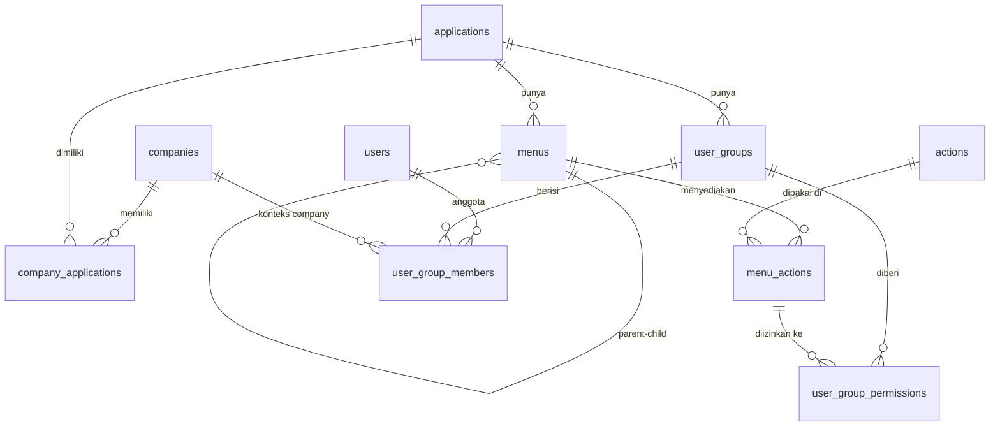

# User Management (RBAC) – Desain Database

Versi 0.5.0 · PostgreSQL 13+ · Schema `usrmgnt` · DDL: `01_user_management.sql`

Konvensi penamaan: nama tabel memakai kata benda jamak sesuai peruntukannya (`companies`, `users`, dst.), tanpa prefix `mst_`/`map_`. Kolom memakai snake_case.

## 1. ERD



Alur hak akses: **User → (user_group_members, per Company) → Group → (user_group_permissions) → Menu + Action**

Group dan pengaturan aksesnya dibuat sekali per aplikasi. Saat user dimasukkan ke group, ditentukan juga untuk company mana keanggotaan itu berlaku. Company tersebut wajib memiliki aplikasi group-nya di `company_applications`.

## 2. Daftar Tabel

| # | Tabel | Fungsi | Unique key bisnis |
|---|---|---|---|
| 1 | `companies` | Daftar perusahaan | `company_code` |
| 2 | `applications` | Daftar aplikasi, berdiri sendiri (tanpa relasi ke company) | `app_code` |
| 2b | `company_applications` | Pemetaan aplikasi yang dimiliki company (M:N) | `company_id + application_id` |
| 3 | `menus` | Menu per aplikasi, hirarkis via `parent_id` | `application_id + menu_code` |
| 4a | `actions` | Katalog action global (CRUD, PRINT, EXPORT_EXCEL, …) | `action_code` |
| 4b | `menu_actions` | Action yang **tersedia** di sebuah menu | `menu_id + action_id` |
| 5 | `user_groups` | Group akses per aplikasi (1:N) | `application_id + group_code` |
| 6 | `users` | User global (satu akun lintas company/aplikasi) | `lower(username)`, `lower(email)` |
| 7 | `user_group_members` | User ↔ Group per company, dengan masa berlaku | `user_id + user_group_id + company_id` |
| 8 | `user_group_permissions` | Action yang **diizinkan** untuk group pada menu | `user_group_id + menu_action_id` |

Semua unique key berbentuk *partial index* `WHERE is_deleted = false`, sehingga kode yang sudah di-soft-delete dapat dipakai ulang.

## 3. Audit Field Standar (semua tabel)

| Field | Tipe | Default | Keterangan |
|---|---|---|---|
| `created_by` | varchar(100) | – (NOT NULL) | Username pembuat |
| `created_at` | timestamptz | `now()` | Waktu dibuat |
| `updated_by` | varchar(100) | NULL | Username pengubah terakhir |
| `updated_at` | timestamptz | NULL | Diisi otomatis oleh trigger saat UPDATE |
| `deleted_by` | varchar(100) | NULL | Username penghapus |
| `deleted_at` | timestamptz | NULL | Waktu soft delete |`
| `is_deleted` | boolean | `false` | Status soft delete |
| `is_active` | boolean | `true` | Status aktif row |

## 4. Field Spesifik per Tabel

**companies**: `company_code`, `company_name`, `short_name`, `tax_number` (NPWP), `address`, `phone`, `email`, `logo_url`

**applications**: `app_code`, `app_name`, `description`, `base_url`, `icon`, `sort_order`

**company_applications**: `company_id` (FK), `application_id` (FK)

**menus**: `application_id` (FK), `parent_id` (FK self), `menu_code`, `menu_name`, `menu_type` (`GROUP`/`PAGE`), `route_path`, `icon`, `sort_order`, `is_visible`

**actions**: `action_code`, `action_name`, `description`, `is_default` (true = otomatis ditempel ke menu PAGE baru), `sort_order`

**menu_actions**: `menu_id` (FK), `action_id` (FK)

**user_groups**: `application_id` (FK), `group_code`, `group_name`, `description`

**users**: `username`, `email`, `full_name`, `employee_no`, `phone`, `auth_provider` (`LOCAL`/`LDAP`/`SSO`), `password_hash`, `password_changed_at`, `must_change_password`, `failed_login_count`, `is_locked`, `locked_at`, `last_login_at`

**user_group_members**: `user_id` (FK), `user_group_id` (FK), `company_id` (FK), `valid_from`, `valid_to`

**user_group_permissions**: `user_group_id` (FK), `menu_action_id` (FK)

## 5. Aturan Bisnis yang Ditegakkan di Database

1. Parent menu wajib berasal dari aplikasi yang sama (`trg_menus_validate_parent`).
2. Group hanya bisa diberi permission atas menu dari aplikasinya sendiri (`trg_user_group_permissions_validate`).
3. Menu bertipe `PAGE` otomatis mendapat action default CREATE/READ/UPDATE/DELETE (`trg_menus_default_actions`). Action tambahan (PRINT, EXPORT_EXCEL) ditambahkan manual ke `menu_actions`.
4. User `LOCAL` wajib memiliki `password_hash`.
5. `updated_at` terisi otomatis di setiap UPDATE.
6. Company pada `user_group_members` wajib memiliki aplikasi dari group tersebut di `company_applications` (`trg_user_group_members_validate_company`).

## 6. View `user_effective_permissions`

Mengembalikan hak akses efektif per user per company (`user_id`, `company`, `application`, `menu`, `action_code`) dengan memfilter semua row yang tidak aktif (termasuk company dan pemetaan `company_applications`), ter-soft-delete, user yang terkunci, dan keanggotaan group di luar masa berlaku. Dipakai backend untuk membangun sidebar menu dan otorisasi endpoint.

```sql
-- Contoh: apakah user boleh export di menu SHIPMENT aplikasi BILLCOST untuk company MDN?
SELECT EXISTS (
  SELECT 1 FROM usrmgnt.user_effective_permissions
  WHERE username = 'jdoe' AND company_code = 'MDN' AND app_code = 'BILLCOST'
    AND menu_code = 'SHIPMENT' AND action_code = 'EXPORT_EXCEL'
);
```

## 7. Riwayat Perubahan

| Versi | Perubahan |
|---|---|
| 0.1.0 | Desain awal RBAC: company, application, menu, action, user group, user, beserta tabel relasi dan view hak akses |
| 0.2.0 | Nama tabel diganti menjadi kata benda jamak tanpa prefix `mst_`/`map_` (`companies`, `applications`, `menus`, `actions`, `menu_actions`, `user_groups`, `users`, `user_group_members`, `user_group_permissions`); view menjadi `user_effective_permissions` |
| 0.3.0 | Nama skema diganti dari `usm` menjadi `usrmgnt` |
| 0.4.0 | `applications` berdiri sendiri: kolom `company_id` dan relasi ke `companies` dihapus, `app_code` unik global. Tabel baru `company_applications` memetakan aplikasi yang dimiliki company (M:N). Kolom company dihapus dari view `user_effective_permissions` |
| 0.5.0 | Keanggotaan group kini per company: kolom `company_id` ditambahkan di `user_group_members` (unique `user_id + user_group_id + company_id`), divalidasi trigger terhadap `company_applications`. View `user_effective_permissions` kembali menampilkan `company_id` dan `company_code` |
