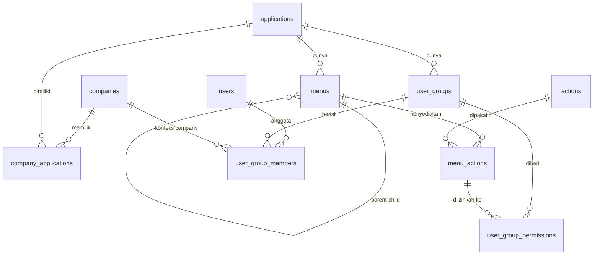

# PRD – User Management (RBAC) MODENA Framework

| Item | Keterangan |
|---|---|
| Dokumen | Product Requirements Document – Modul User Management |
| Versi | 1.0 (draft) |
| Tanggal | 13 Oktober 2026 |
| Pemilik | Divisi IT MODENA Indonesia |
| Acuan database | `database/01_user_management.sql` (v0.5.0), `database/02_seed_sample_data.sql` |
| Tujuan dokumen | Acuan tunggal untuk pengembangan (termasuk *vibe coding* dengan AI coding agent) |

**Cara membaca label di dokumen ini**

- **[D] Keputusan**: sudah diputuskan oleh pemilik produk selama diskusi desain. Wajib diikuti.
- **[U] Usulan**: rekomendasi/asumsi analis (Claude), belum dikonfirmasi. Boleh dipakai sebagai default, tetapi tandai bila diubah.

> **Instruksi untuk AI coding agent:** Database adalah *source of truth*. Jangan membuat ulang atau mengubah struktur tabel di luar file SQL di folder `database/`. Ikuti nama tabel, kolom, kode menu, dan kode action persis seperti di dokumen ini. Bila ada hal yang tidak tercakup, tanyakan atau catat sebagai *open issue*; jangan berasumsi diam-diam.

---

## 1. Latar Belakang dan Tujuan

MODENA membangun framework pengembangan aplikasi internal. Modul pertama dan fondasinya adalah **User Management** berbasis **Role-Based Access Control (RBAC)** yang dapat dipakai bersama oleh banyak aplikasi dan banyak perusahaan (company).

**Tujuan**

1. Satu sumber data user, group, dan hak akses untuk seluruh aplikasi internal.
2. Hak akses dapat diatur sampai level **action per menu** (CREATE, READ, UPDATE, DELETE, PRINT, EXPORT_EXCEL, dan action tambahan).
3. Satu user dapat memiliki akses berbeda di company dan aplikasi yang berbeda.
4. Semua perubahan data tercatat (audit field) dan tidak ada data yang dihapus permanen (soft delete).

**Ukuran keberhasilan [U]**

- Aplikasi baru (mis. Billing Cost) cukup mendaftarkan menu dan action-nya di modul ini tanpa membuat tabel user sendiri.
- Seluruh endpoint API aplikasi terlindungi oleh pengecekan permission yang sama (middleware tunggal).

## 2. Ruang Lingkup

### 2.1 Fase 1 (MVP) – dalam lingkup

| # | Fitur |
|---|---|
| 1 | Login LOCAL (username + password), logout, refresh token, ganti password **[D]** |
| 2 | Pemilihan konteks aktif (company + aplikasi) setelah login |
| 3 | Sidebar menu dinamis sesuai hak akses |
| 4 | Middleware otorisasi berbasis menu + action |
| 5 | CRUD master: Companies, Applications, Menus (+ action per menu), Actions, Users |
| 6 | Pemetaan: Company Applications, User Groups, Group Members, Group Permissions (matriks) |
| 7 | Soft delete, restore, aktif/nonaktif, lock/unlock user, reset password |
| 8 | Export Excel daftar user; Import Excel user **[U]** (karena action tersedia di seed) |

### 2.2 Di luar lingkup Fase 1

- Login LDAP / SSO (kolom `auth_provider` sudah tersedia) → **Fase 2 [D]**
- Audit log riwayat perubahan per field (tabel terpisah) → Fase 2 **[U]**
- Riwayat login / session management lintas device → Fase 2 **[U]**
- Pembatasan admin per company (admin company A hanya mengelola data company A) → lihat *Open Issue* OI-01
- Fitur bisnis aplikasi lain (Billing Cost, dll.)

## 3. Glosarium

| Istilah | Arti |
|---|---|
| Company | Perusahaan/entitas (tabel `companies`) |
| Application | Aplikasi internal; berdiri sendiri, tidak terikat ke satu company (tabel `applications`) |
| Company Application | Pemetaan aplikasi yang dimiliki company (tabel `company_applications`) |
| Menu | Item navigasi aplikasi. `GROUP` = folder/header, `PAGE` = halaman |
| Action | Operasi yang dapat dilakukan di menu (CREATE, READ, …) |
| Menu Action | Action yang **tersedia** di sebuah menu (tabel `menu_actions`) |
| User Group | Kumpulan hak akses dalam satu aplikasi (tabel `user_groups`) |
| Group Permission | Action yang **diizinkan** untuk group pada menu tertentu (tabel `user_group_permissions`) |
| Group Member | Keanggotaan user di group **untuk company tertentu**, dengan masa berlaku (tabel `user_group_members`) |
| Konteks aktif | Pasangan company + aplikasi yang sedang digunakan user dalam satu sesi |
| Permission key | Pasangan `menu_code` + `action_code`, mis. `UM_USER:CREATE` |

## 4. Pengguna (Persona)

| Persona | Group (aplikasi USRMGNT) | Kebutuhan |
|---|---|---|
| Super Administrator IT | `SUPER_ADMIN` | Mengelola seluruh master, group, dan hak akses |
| Auditor | `UM_AUDITOR` | Melihat konfigurasi akses dan export daftar user, tanpa mengubah |
| Admin aplikasi (mis. Billing Admin) | Group admin di aplikasinya | Memakai aplikasinya sendiri; tidak mengelola user **[U]** |
| User operasional | Group di aplikasinya | Login, memilih company/aplikasi, memakai menu sesuai akses |

## 5. Arsitektur dan Tech Stack

### 5.1 Stack **[D]** (disamakan dengan project Billing Cost)

| Layer | Teknologi |
|---|---|
| Frontend | React 18, TypeScript, Vite, Tailwind CSS, Axios, React Router 6. State management: belum ditetapkan, usulan **TanStack Query** untuk data server + **Zustand** untuk state sesi **[U]** |
| Backend | Node.js 20 LTS, Express 4, TypeScript, Prisma 5, JWT, Zod (validasi), Multer (upload Excel) |
| Database | PostgreSQL 16, schema `usrmgnt` |
| Cache | Redis 7 (cache permission, penyimpanan refresh token) |
| Excel | `exceljs` **[U]** |
| Hash password | `bcrypt`, cost 10 **[U]** (sesuai hash di data seed) |

### 5.2 Struktur repository **[U]**

```
MODENA-FRMWRK/
├── database/
│   ├── 01_user_management.sql      # DDL (source of truth)
│   ├── 01_user_management.md       # data dictionary + ERD
│   └── 02_seed_sample_data.sql     # data contoh
├── docs/
│   └── PRD_user_management.md      # dokumen ini
├── apps/
│   ├── api/                        # Express + Prisma
│   │   ├── prisma/schema.prisma    # hasil `prisma db pull`
│   │   └── src/
│   │       ├── config/             # env, db, redis
│   │       ├── middlewares/        # auth, authorize, error, audit
│   │       ├── modules/<nama>/     # route, controller, service, schema (zod)
│   │       └── utils/
│   └── web/                        # React + Vite
│       └── src/
│           ├── api/                # axios client + endpoint
│           ├── components/
│           ├── hooks/              # usePermission, useAuth
│           ├── layouts/            # AppLayout (header, sidebar)
│           ├── pages/usrmgnt/<halaman>/
│           └── routes/
└── .env.example
```

### 5.3 Catatan Prisma (penting untuk AI agent) **[U]**

1. DDL dikelola lewat file SQL di `database/`, **bukan** lewat `prisma migrate`. Gunakan `prisma db pull` untuk menghasilkan `schema.prisma`, dan perlakukan file itu sebagai hasil generate.
2. Schema database bukan `public`, jadi perlu fitur `multiSchema` Prisma dan `schemas = ["usrmgnt"]` pada datasource. Di Prisma 5 fitur ini masih *preview*; verifikasi saat setup.
3. Unique index di database berbentuk *partial index* (`WHERE is_deleted = false`) yang tidak bisa direpresentasikan di `schema.prisma`. Jangan pakai `upsert`/`findUnique` berbasis kode bisnis; gunakan `findFirst` dengan filter `isDeleted: false`, dan tangani error unique dari database (kode Prisma `P2002`) sebagai error validasi.
4. View `user_effective_permissions` dibaca dengan `prisma.$queryRaw` (atau fitur `views` yang masih preview).
5. Trigger database (validasi parent menu, validasi company group member, default CRUD menu, `updated_at`) **sudah ada**; backend tidak perlu menduplikasi logikanya, tetapi wajib menerjemahkan error trigger menjadi pesan yang ramah (lihat §8.3).

## 6. Model Data (ringkas)

Detail kolom ada di `database/01_user_management.md`. Ringkasan relasi:



**Alur hak akses:** User → `user_group_members` (per company, dengan masa berlaku) → `user_groups` (per aplikasi) → `user_group_permissions` → `menu_actions` (menu + action).

**Audit field di semua tabel [D]:** `created_by`, `created_at`, `updated_by`, `updated_at`, `deleted_by`, `deleted_at`, `is_deleted` (default false), `is_active` (default true).

## 7. Aturan Bisnis

| Kode | Aturan | Status | Ditegakkan di |
|---|---|---|---|
| BR-01 | Satu company dapat memiliki banyak aplikasi, dan satu aplikasi dapat dimiliki banyak company (via `company_applications`) | [D] | DB |
| BR-02 | `applications` berdiri sendiri, tanpa relasi langsung ke `companies` | [D] | DB |
| BR-03 | Satu aplikasi memiliki banyak menu; menu boleh bertingkat dan parent harus dari aplikasi yang sama | [D] | DB (trigger) |
| BR-04 | Setiap menu `PAGE` baru otomatis mendapat action default (yang `is_default = true`: CREATE, READ, UPDATE, DELETE) | [D] | DB (trigger) |
| BR-05 | Action tambahan (PRINT, EXPORT_EXCEL, APPROVE, IMPORT_EXCEL, dll.) dapat ditambahkan ke katalog dan dipasang ke menu tertentu | [D] | API |
| BR-06 | Satu aplikasi memiliki banyak user group; group hanya boleh diberi permission atas menu dari aplikasinya sendiri | [D] | DB (trigger) |
| BR-07 | Keanggotaan user di group selalu untuk company tertentu, dan company itu wajib memiliki aplikasi group tersebut | [D] | DB (trigger) |
| BR-08 | Satu user dapat menjadi anggota banyak group, lintas aplikasi dan company | [D] | DB |
| BR-09 | Hak akses efektif = gabungan (union) seluruh permission dari semua group aktif user pada konteks company + aplikasi | [U] | API |
| BR-10 | Hak akses hanya berlaku bila user, keanggotaan (dalam masa berlaku), group, aplikasi, company, pemetaan company-aplikasi, menu, menu-action, dan action semuanya aktif dan tidak terhapus | [D] | DB (view) |
| BR-11 | Tidak ada hapus permanen; DELETE = set `is_deleted = true`, `deleted_by`, `deleted_at` | [D] | API |
| BR-12 | Kode bisnis (company_code, app_code, menu_code, group_code, username, email) unik di antara data yang belum dihapus; kode dari data terhapus boleh dipakai ulang | [D] | DB |
| BR-13 | Username dan email unik tanpa membedakan huruf besar/kecil | [D] | DB |
| BR-14 | User `LOCAL` wajib memiliki password | [D] | DB |
| BR-15 | `created_by` / `updated_by` / `deleted_by` diisi **username** user yang login (dari JWT), bukan input client | [U] | API |
| BR-16 | Login gagal 5 kali berturut-turut → user terkunci (`is_locked = true`, `locked_at = now()`); login sukses mereset `failed_login_count` | [U] | API |
| BR-17 | User dengan `must_change_password = true` wajib ganti password sebelum dapat mengakses menu lain | [U] | API + Web |
| BR-18 | Kebijakan password: minimal 8 karakter, mengandung huruf besar, huruf kecil, angka, dan simbol; tidak sama dengan password lama | [U] | API |
| BR-19 | User tidak dapat menghapus, menonaktifkan, atau mengunci akunnya sendiri | [U] | API |
| BR-20 | Group `SUPER_ADMIN` di aplikasi USRMGNT minimal harus memiliki 1 anggota aktif | [U] | API |
| BR-21 | Menghapus data induk (company, aplikasi, menu, group, action) ditolak selama masih dipakai oleh data turunan yang aktif; pesan error menyebutkan jumlah data yang masih terkait | [U] | API |
| BR-22 | Perubahan permission, keanggotaan, status user/group/menu wajib menghapus cache permission yang terdampak di Redis | [U] | API |

## 8. Kebutuhan Fungsional

### 8.1 Autentikasi dan Sesi

**FR-AUTH-01 Login**
- Input: `username`, `password`. Username dicocokkan tanpa membedakan huruf besar/kecil.
- Ditolak bila: user tidak ditemukan, terhapus, nonaktif, terkunci, atau `auth_provider` bukan LOCAL (pesan: "Metode login belum didukung").
- Pesan gagal untuk username/password salah bersifat umum: "Username atau password salah" (tidak membocorkan mana yang salah).
- Sukses: update `last_login_at`, reset `failed_login_count`, kembalikan access token + refresh token + profil singkat + daftar konteks yang tersedia.

**FR-AUTH-02 Token [U]**
- Access token JWT, masa berlaku 15 menit. Claim: `sub` (user_id), `username`, `ctx` (opsional: `company_id`, `application_id`).
- Refresh token acak, masa berlaku 7 hari, disimpan di Redis (`refresh:{token}` → user_id) dan dikirim via cookie `httpOnly`, `secure`, `sameSite=strict`. Rotasi setiap kali refresh.
- Logout menghapus refresh token dari Redis.

**FR-AUTH-03 Pilih konteks**
- `GET /auth/contexts` mengembalikan daftar pasangan company + aplikasi yang dapat diakses user (berasal dari `user_effective_permissions`, di-*group* per company dan aplikasi).
- `POST /auth/context` dengan `company_id` + `application_id` → validasi user punya akses → terbitkan access token baru dengan claim `ctx`.
- Bila hanya ada satu konteks, frontend memilihnya otomatis.
- Header aplikasi menampilkan company dan aplikasi aktif, serta tombol untuk berganti konteks.

**FR-AUTH-04 Menu dan permission sesi**
- `GET /auth/menus` → pohon menu untuk konteks aktif. Sumber: halaman (`PAGE`) dari `user_effective_permissions` yang punya action `READ`, ditambah seluruh menu `GROUP` leluhurnya (ditelusuri lewat `parent_id`). Urut berdasarkan `sort_order`. Menu `is_visible = false` tidak ditampilkan di sidebar, tetapi tetap boleh diakses lewat route.
- `GET /auth/permissions` → array permission key, mis. `["UM_USER:READ","UM_USER:CREATE"]`.

**FR-AUTH-05 Ganti password**
- Input: `old_password`, `new_password`, `confirm_password`. Validasi BR-18.
- Sukses: update `password_hash`, `password_changed_at`, set `must_change_password = false`, cabut semua refresh token user.

**FR-AUTH-06 Profil**
- `GET /auth/me` → id, username, full_name, email, employee_no, konteks aktif, `must_change_password`.

### 8.2 Otorisasi

**FR-AUTHZ-01 Middleware `authorize(menuCode, actionCode)`**
1. Ambil `sub` dan `ctx` dari access token. Tanpa `ctx` → 403 `CONTEXT_REQUIRED`.
2. Ambil set permission dari Redis `perm:{user_id}:{company_id}:{application_id}` (TTL 10 menit **[U]**). Bila tidak ada, query `user_effective_permissions` lalu simpan ke Redis.
3. Bila `menuCode:actionCode` tidak ada di set → 403 `FORBIDDEN`.

**FR-AUTHZ-02 Pemetaan endpoint → permission** wajib mengikuti tabel API di §9. Endpoint `/auth/*` hanya butuh token valid.

**FR-AUTHZ-03 Frontend**
- Hook `usePermission(menuCode, actionCode): boolean`.
- Tombol/aksi disembunyikan bila tidak ada permission (mis. tombol "Tambah" butuh `CREATE`, "Ubah" butuh `UPDATE`, "Hapus" butuh `DELETE`, "Cetak" butuh `PRINT`, "Export" butuh `EXPORT_EXCEL`, "Import" butuh `IMPORT_EXCEL`).
- Route guard: halaman tanpa permission `READ` → tampilkan halaman 403.
- Penyembunyian di frontend hanya untuk kenyamanan; backend tetap wajib memeriksa.

### 8.3 Pola Umum untuk Semua Master (berlaku untuk §8.4–§8.12)

| Fitur | Ketentuan |
|---|---|
| List | Paginasi server-side (`page`, `page_size` default 20, maks 100), pencarian `q` (kode/nama, case-insensitive), filter `is_active`, sort `sort_by` + `sort_dir`. Default hanya data `is_deleted = false`; parameter `include_deleted=true` hanya untuk user dengan permission UPDATE **[U]** |
| Detail | `GET /:id`; 404 bila tidak ada atau terhapus |
| Create | Validasi Zod; `created_by` dari JWT |
| Update | `PUT /:id` berisi seluruh field yang dapat diedit; field kode bisnis **tidak dapat diubah** setelah dibuat **[U]**; `updated_by` dari JWT |
| Delete | Soft delete (BR-11), cek BR-21 |
| Restore | `POST /:id/restore` → `is_deleted = false`, kosongkan `deleted_by`/`deleted_at`. Gagal bila kode sudah dipakai data aktif lain. Permission: `UPDATE` |
| Aktif/Nonaktif | `PATCH /:id/status` body `{ "is_active": boolean }`. Permission: `UPDATE` |
| Error unique (P2002 / 23505) | 409 `DUPLICATE`, pesan "Kode <x> sudah digunakan" |
| Error trigger (P0001) | 422 `BUSINESS_RULE`, teruskan pesan dari database |
| Error FK (23503) | 422 `REFERENCE_NOT_FOUND` |

### 8.4 Companies – menu `UM_COMPANY`
- Field input: `company_code` (wajib, maks 20, huruf besar/angka/underscore **[U]**), `company_name` (wajib), `short_name`, `tax_number`, `address`, `phone`, `email` (format email), `logo_url`.
- Delete ditolak bila masih ada `company_applications` atau `user_group_members` aktif.

### 8.5 Applications – menu `UM_APPLICATION`
- Field: `app_code` (wajib, unik global), `app_name` (wajib), `description`, `base_url`, `icon`, `sort_order`.
- Delete ditolak bila masih ada menu, group, atau pemetaan company aktif.

### 8.6 Company Applications – menu `UM_COMPANY_APP`
- Tampilan per company: daftar aplikasi dengan checkbox/toggle.
- Endpoint: list per company, tambah pemetaan, hapus pemetaan.
- Hapus pemetaan ditolak bila masih ada `user_group_members` aktif untuk company + aplikasi tersebut (menutup catatan desain v0.5.0) **[U]**.

### 8.7 Actions – menu `UM_ACTION`
- Field: `action_code` (wajib, huruf besar + underscore), `action_name`, `description`, `is_default`, `sort_order`.
- 4 action bawaan (CREATE, READ, UPDATE, DELETE) **tidak dapat dihapus atau diubah kodenya [U]**.
- Mengubah `is_default` hanya berlaku untuk menu yang dibuat setelahnya (tidak retroaktif).

### 8.8 Menus – menu `UM_MENU`
- Tampilan: pilih aplikasi → *tree view* menu (drag-and-drop urutan bersifat opsional **[U]**).
- Field: `application_id`, `parent_id` (hanya menu `GROUP` dari aplikasi yang sama), `menu_code`, `menu_name`, `menu_type` (`GROUP`/`PAGE`), `route_path` (wajib untuk `PAGE`), `icon`, `sort_order`, `is_visible`.
- `menu_type` tidak dapat diubah setelah dibuat **[U]**.
- Sub-fitur **Action per menu** (hanya `PAGE`): daftar checkbox seluruh action aktif; simpan sebagai set lengkap (`PUT /menus/:id/actions`). Action yang dilepas → soft delete `menu_actions`, dan permission group yang memakainya ikut di-soft-delete **[U]**.
- Delete menu `GROUP` ditolak bila masih memiliki child aktif.

### 8.9 Users – menu `UM_USER`
- Field: `username` (wajib, 3–100 karakter, huruf kecil/angka/titik/underscore **[U]**), `email` (wajib), `full_name` (wajib), `employee_no`, `phone`, `auth_provider` (Fase 1 hanya `LOCAL` yang dapat dipilih **[U]**).
- Create: admin memasukkan password awal **atau** sistem membangkitkan password acak yang ditampilkan sekali **[U]**; `must_change_password = true`.
- Aksi tambahan (permission `UPDATE`): **Reset password** (`POST /users/:id/reset-password` → password acak, `must_change_password = true`, cabut refresh token), **Unlock** (`POST /users/:id/unlock` → `is_locked = false`, `failed_login_count = 0`, `locked_at = null`), **Lock** (`POST /users/:id/lock`).
- Response API **tidak pernah** mengembalikan `password_hash`.
- Tab "Akses" di detail user: daftar keanggotaan group (company, aplikasi, group, masa berlaku, status).
- **Export Excel** (`EXPORT_EXCEL`): kolom username, full_name, email, employee_no, auth_provider, is_active, is_locked, last_login_at; mengikuti filter list.
- **Import Excel** (`IMPORT_EXCEL`): template tersedia untuk diunduh; validasi seluruh baris dulu, tampilkan daftar error per baris; simpan hanya bila semua baris valid (*all-or-nothing*) **[U]**.

### 8.10 User Groups – menu `UM_GROUP`
- Tampilan: filter per aplikasi.
- Field: `application_id`, `group_code`, `group_name`, `description`. `application_id` tidak dapat diubah setelah dibuat **[U]**.
- Fitur **Duplikat group** (salin permission ke group baru di aplikasi yang sama) **[U]**, opsional di Fase 1.
- Delete ditolak bila masih memiliki anggota aktif.

### 8.11 Group Members – menu `UM_GROUP_MEMBER`
- Tampilan: pilih group → daftar anggota (username, nama, company, valid_from, valid_to, status).
- Tambah anggota: pilih user (pencarian), pilih company (dropdown hanya company yang memiliki aplikasi group tersebut), `valid_from` (default hari ini), `valid_to` (opsional, ≥ valid_from).
- Ubah: hanya `valid_from`, `valid_to`, `is_active`.
- Hapus: soft delete.

### 8.12 Group Permissions – menu `UM_GROUP_PERM`
- Tampilan **matriks**: baris = menu (tree, indentasi sesuai hirarki), kolom = action. Sel yang action-nya tidak tersedia di menu tersebut ditampilkan nonaktif.
- Shortcut: centang semua per baris, per kolom, dan seluruhnya.
- Simpan sebagai set lengkap: `PUT /user-groups/:id/permissions` body `{ "menu_action_ids": [...] }` → service menghitung selisih: tambah yang baru, soft delete yang dilepas, dalam satu transaksi.
- Setelah simpan: invalidasi cache permission seluruh anggota group (BR-22).

## 9. Kontrak API

### 9.1 Konvensi

- Base URL: `/api/v1`
- Format JSON, nama field **snake_case** (sama dengan kolom database) **[U]**
- Tanggal dikirim ISO 8601 UTC; frontend menampilkan dalam zona Asia/Jakarta
- Header: `Authorization: Bearer <access_token>`

**Response sukses**
```json
{ "success": true, "data": {}, "message": "OK", "meta": { "page": 1, "page_size": 20, "total": 125 } }
```

**Response error**
```json
{ "success": false, "error": { "code": "VALIDATION_ERROR", "message": "Data tidak valid", "details": [ { "field": "email", "message": "Format email tidak valid" } ] } }
```

| HTTP | `error.code` |
|---|---|
| 400 | `VALIDATION_ERROR` |
| 401 | `UNAUTHENTICATED`, `TOKEN_EXPIRED`, `INVALID_CREDENTIALS`, `ACCOUNT_LOCKED`, `ACCOUNT_INACTIVE` |
| 403 | `FORBIDDEN`, `CONTEXT_REQUIRED`, `PASSWORD_CHANGE_REQUIRED` |
| 404 | `NOT_FOUND` |
| 409 | `DUPLICATE` |
| 422 | `BUSINESS_RULE`, `REFERENCE_NOT_FOUND`, `IN_USE` |
| 429 | `TOO_MANY_REQUESTS` |
| 500 | `INTERNAL_ERROR` |

### 9.2 Endpoint

**Auth (cukup token valid)**

| Method | Path | Keterangan |
|---|---|---|
| POST | `/auth/login` | Login (tanpa token) |
| POST | `/auth/refresh` | Refresh token (cookie) |
| POST | `/auth/logout` | Logout |
| GET | `/auth/me` | Profil |
| POST | `/auth/change-password` | Ganti password |
| GET | `/auth/contexts` | Daftar company + aplikasi yang dapat diakses |
| POST | `/auth/context` | Pilih konteks aktif |
| GET | `/auth/menus` | Pohon menu konteks aktif |
| GET | `/auth/permissions` | Daftar permission key konteks aktif |

**Master dan pemetaan** (konteks aktif harus aplikasi `USRMGNT`)

| Method | Path | Permission |
|---|---|---|
| GET | `/companies` · `/companies/:id` | `UM_COMPANY:READ` |
| POST | `/companies` | `UM_COMPANY:CREATE` |
| PUT · PATCH status · POST restore | `/companies/:id` … | `UM_COMPANY:UPDATE` |
| DELETE | `/companies/:id` | `UM_COMPANY:DELETE` |
| GET/POST/PUT/PATCH/DELETE | `/applications` … | `UM_APPLICATION:*` (pola sama) |
| GET | `/companies/:id/applications` | `UM_COMPANY_APP:READ` |
| POST | `/companies/:id/applications` body `{application_id}` | `UM_COMPANY_APP:CREATE` |
| DELETE | `/companies/:id/applications/:applicationId` | `UM_COMPANY_APP:DELETE` |
| GET/POST/PUT/PATCH/DELETE | `/actions` … | `UM_ACTION:*` |
| GET | `/applications/:id/menus/tree` | `UM_MENU:READ` |
| GET/POST/PUT/PATCH/DELETE | `/menus` … | `UM_MENU:*` |
| GET | `/menus/:id/actions` | `UM_MENU:READ` |
| PUT | `/menus/:id/actions` body `{action_ids}` | `UM_MENU:UPDATE` |
| GET/POST/PUT/PATCH/DELETE | `/users` … | `UM_USER:*` |
| POST | `/users/:id/reset-password` · `/lock` · `/unlock` | `UM_USER:UPDATE` |
| GET | `/users/:id/memberships` | `UM_USER:READ` |
| GET | `/users/export` | `UM_USER:EXPORT_EXCEL` |
| GET | `/users/import/template` · POST `/users/import` | `UM_USER:IMPORT_EXCEL` |
| GET/POST/PUT/PATCH/DELETE | `/user-groups` … | `UM_GROUP:*` |
| GET | `/user-groups/:id/members` | `UM_GROUP_MEMBER:READ` |
| POST | `/user-groups/:id/members` | `UM_GROUP_MEMBER:CREATE` |
| PUT | `/user-groups/:id/members/:memberId` | `UM_GROUP_MEMBER:UPDATE` |
| DELETE | `/user-groups/:id/members/:memberId` | `UM_GROUP_MEMBER:DELETE` |
| GET | `/user-groups/:id/permissions` (matriks) | `UM_GROUP_PERM:READ` |
| PUT | `/user-groups/:id/permissions` body `{menu_action_ids}` | `UM_GROUP_PERM:UPDATE` |

**Lookup untuk dropdown [U]**: `GET /lookups/companies`, `/lookups/applications`, `/lookups/actions`, `/lookups/users?q=` → hanya data aktif, field ringkas (`id`, `code`, `name`). Cukup token + konteks USRMGNT.

### 9.3 Contoh: login

Request `POST /api/v1/auth/login`
```json
{ "username": "bc.staff", "password": "Modena@2026" }
```
Response 200
```json
{
  "success": true,
  "data": {
    "access_token": "eyJ...",
    "expires_in": 900,
    "user": { "id": "uuid", "username": "bc.staff", "full_name": "Citra Billing Staff", "must_change_password": true },
    "contexts": [
      { "company_id": "uuid", "company_code": "DEMO1", "application_id": "uuid", "app_code": "BILLCOST" },
      { "company_id": "uuid", "company_code": "MDN",   "application_id": "uuid", "app_code": "BILLCOST" }
    ]
  }
}
```

### 9.4 Contoh: menu tree

`GET /api/v1/auth/menus`
```json
{
  "success": true,
  "data": [
    { "menu_code": "BC_TRX", "menu_name": "Transaction", "menu_type": "GROUP", "icon": "edit", "children": [
      { "menu_code": "BC_SHIPMENT", "menu_name": "Project Cost Shipment", "menu_type": "PAGE", "route_path": "/billcost/shipments",
        "actions": ["CREATE","READ","UPDATE","PRINT","IMPORT_EXCEL"] }
    ]}
  ]
}
```

## 10. Kebutuhan UI/UX

| Halaman | Route | Isi utama |
|---|---|---|
| Login | `/login` | Form username + password, pesan error, tanpa link registrasi |
| Pilih konteks | `/select-context` | Kartu company → aplikasi |
| Ganti password | `/change-password` | Dipaksa tampil bila `must_change_password` |
| Layout aplikasi | – | Header (nama aplikasi, company aktif, pengganti konteks, menu profil/logout), sidebar dari `/auth/menus` |
| Companies | `/usrmgnt/companies` | Tabel + form modal/drawer |
| Applications | `/usrmgnt/applications` | Tabel + form |
| Menus | `/usrmgnt/menus` | Pilih aplikasi, tree menu, panel detail + action per menu |
| Actions | `/usrmgnt/actions` | Tabel + form |
| Users | `/usrmgnt/users` | Tabel, filter status/terkunci, aksi reset/lock/unlock, export/import |
| Company Applications | `/usrmgnt/company-applications` | Pilih company → daftar aplikasi dengan toggle |
| User Groups | `/usrmgnt/user-groups` | Filter aplikasi, tabel + form |
| Group Members | `/usrmgnt/group-members` | Pilih group → tabel anggota |
| Group Permissions | `/usrmgnt/group-permissions` | Pilih group → matriks menu × action |
| 403 / 404 | `/403`, `/404` | Halaman informasi |

Route frontend wajib sama dengan `route_path` di tabel `menus` (lihat data seed).

**Standar komponen [U]**: tabel dengan paginasi + pencarian + badge status (Aktif/Nonaktif/Terhapus/Terkunci); konfirmasi dialog sebelum hapus, nonaktif, reset password; toast untuk sukses/gagal; validasi form inline dengan pesan Bahasa Indonesia; layout responsif minimal untuk lebar 1280px (desktop) dan tetap bisa dipakai di tablet.

## 11. Kebutuhan Non-Fungsional [U]

| Aspek | Kebutuhan |
|---|---|
| Keamanan | `helmet`, CORS hanya untuk origin yang terdaftar, rate limit login 10 request/menit per IP, input divalidasi Zod di semua endpoint, query hanya lewat Prisma/parameterized, tidak ada `password_hash` di response maupun log |
| Kinerja | Endpoint list < 500 ms untuk 10.000 baris; pengecekan permission dari cache < 10 ms |
| Konsistensi data | Operasi set (permission matriks, action per menu, import) dalam satu transaksi database |
| Logging | Log request terstruktur (JSON) berisi request id, user_id, method, path, status, durasi |
| Konfigurasi | Semua secret di `.env` (`DATABASE_URL`, `REDIS_URL`, `JWT_SECRET`, `JWT_EXPIRES_IN`, `REFRESH_EXPIRES_IN`, `CORS_ORIGIN`); sediakan `.env.example` |
| Zona waktu | Database `timestamptz`; tampilan Asia/Jakarta |
| Bahasa | Label UI dan pesan error dalam Bahasa Indonesia |
| Testing | Unit test service (Vitest/Jest) dan integration test endpoint auth + authorize terhadap database seed |

## 12. Data Seed dan Akun Uji

Jalankan `01_user_management.sql` lalu `02_seed_sample_data.sql` pada database kosong. Password user LOCAL: **`Modena@2026`**.

| Username | Kondisi | Akses yang diharapkan |
|---|---|---|
| `superadmin` | Normal | USRMGNT penuh di MDN dan DEMO1 |
| `auditor` | Normal | USRMGNT hanya READ (+ export user) di MDN |
| `bc.admin` | Normal | BILLCOST penuh di MDN |
| `bc.staff` | `must_change_password = true` | BILLCOST Staff di MDN, Viewer di DEMO1 |
| `bc.viewer` | LDAP | Tidak dapat login di Fase 1 (pesan metode login belum didukung) |
| `inv.admin` | Normal | INVDEMO penuh di MDN dan DEMO2 |
| `locked.user` | Terkunci | Login ditolak `ACCOUNT_LOCKED` |
| `inactive.user` | Nonaktif | Login ditolak `ACCOUNT_INACTIVE` |

## 13. Kriteria Penerimaan (Acceptance Criteria)

| Kode | Skenario | Hasil yang diharapkan |
|---|---|---|
| AC-01 | `superadmin` login dengan password benar | 200, mendapat 2 konteks (MDN-USRMGNT, DEMO1-USRMGNT) |
| AC-02 | Login password salah 5 kali | Percobaan ke-5 mengunci akun; percobaan berikutnya `ACCOUNT_LOCKED` |
| AC-03 | `locked.user` / `inactive.user` login | Ditolak dengan kode masing-masing |
| AC-04 | `bc.staff` login | Diarahkan ke ganti password; endpoint lain mengembalikan 403 `PASSWORD_CHANGE_REQUIRED` sampai password diganti |
| AC-05 | `bc.staff` pilih konteks MDN-BILLCOST | Menu Transaction > Project Cost Shipment tampil dengan action CREATE, READ, UPDATE, PRINT, IMPORT_EXCEL (tanpa DELETE/APPROVE) |
| AC-06 | `bc.staff` pilih konteks DEMO1-BILLCOST | Hanya READ dan PRINT |
| AC-07 | `auditor` memanggil `POST /users` | 403 `FORBIDDEN` |
| AC-08 | `superadmin` membuat menu PAGE baru | Menu otomatis memiliki CREATE, READ, UPDATE, DELETE |
| AC-09 | Menambahkan user ke group untuk company yang tidak memiliki aplikasinya | 422 `BUSINESS_RULE` |
| AC-10 | Memberi permission menu aplikasi lain ke group | 422 `BUSINESS_RULE` |
| AC-11 | Membuat company dengan kode yang sudah ada | 409 `DUPLICATE` |
| AC-12 | Menghapus company lalu membuat company baru dengan kode yang sama | Berhasil |
| AC-13 | Mengubah permission group, lalu anggota group memanggil endpoint terkait | Perubahan langsung berlaku (cache sudah diinvalidasi) |
| AC-14 | `valid_to` keanggotaan lewat dari hari ini | Akses dari keanggotaan itu hilang |
| AC-15 | Seluruh insert/update/delete | `created_by`/`updated_by`/`deleted_by` berisi username yang login |
| AC-16 | Response endpoint user mana pun | Tidak mengandung `password_hash` |

## 14. Urutan Pengerjaan untuk Vibe Coding [U]

Kerjakan bertahap; setiap tahap selesai dengan test yang lulus sebelum lanjut.

| Tahap | Pekerjaan | Selesai bila |
|---|---|---|
| 1 | Setup monorepo, `.env.example`, koneksi PostgreSQL + Redis, `prisma db pull`, error handler + format response | Health check `/api/v1/health` OK |
| 2 | Auth: login, refresh, logout, me, change password, lockout | AC-01 s.d. AC-04 lulus |
| 3 | Konteks + menu + permission + middleware `authorize` + cache Redis | AC-05 s.d. AC-07 lulus |
| 4 | Frontend: login, pilih konteks, ganti password, layout + sidebar, `usePermission`, route guard | Navigasi sesuai akses tiap akun uji |
| 5 | CRUD Companies, Applications, Actions, Company Applications (backend + frontend) | AC-11, AC-12 lulus |
| 6 | Menus + action per menu | AC-08 lulus |
| 7 | Users (CRUD, reset/lock/unlock, export/import) | AC-15, AC-16 lulus |
| 8 | User Groups, Group Members, Group Permissions (matriks) | AC-09, AC-10, AC-13, AC-14 lulus |
| 9 | Hardening: rate limit, logging, test integrasi menyeluruh | Seluruh AC lulus |

Contoh prompt pembuka tiap tahap:

> "Baca `docs/PRD_user_management.md` dan `database/01_user_management.md`. Kerjakan **Tahap 2** saja sesuai §8.1, §9, dan §11. Jangan ubah file di `database/`. Tulis test untuk AC-01 sampai AC-04 dan jalankan sampai lulus."

## 15. Open Issues

| Kode | Pertanyaan | Dampak |
|---|---|---|
| OI-01 | Apakah admin USRMGNT perlu dibatasi per company (hanya mengelola user/group untuk company-nya)? Saat ini master bersifat global | Scope data di semua endpoint USRMGNT |
| OI-02 | Konfirmasi kebijakan password (BR-18), batas lockout (BR-16), dan durasi token (FR-AUTH-02) dengan tim keamanan IT | Konfigurasi |
| OI-03 | Apakah satu user boleh login di beberapa device bersamaan? | Penyimpanan refresh token |
| OI-04 | Detail integrasi LDAP/Active Directory MODENA untuk Fase 2 (host, base DN, atribut username) | Fase 2 |
| OI-05 | Apakah perlu tabel audit log terpisah (riwayat perubahan nilai field), selain audit field per baris? | Fase 2 |
| OI-06 | Bagaimana aplikasi lain (mis. Billing Cost) memakai modul ini: berbagi database yang sama, atau memanggil API User Management sebagai layanan terpusat? | Arsitektur integrasi |

## 16. Riwayat Dokumen

| Versi | Tanggal | Perubahan |
|---|---|---|
| 1.0 | 13-10-2026 | Draft awal berdasarkan desain database v0.5.0 dan data seed |
