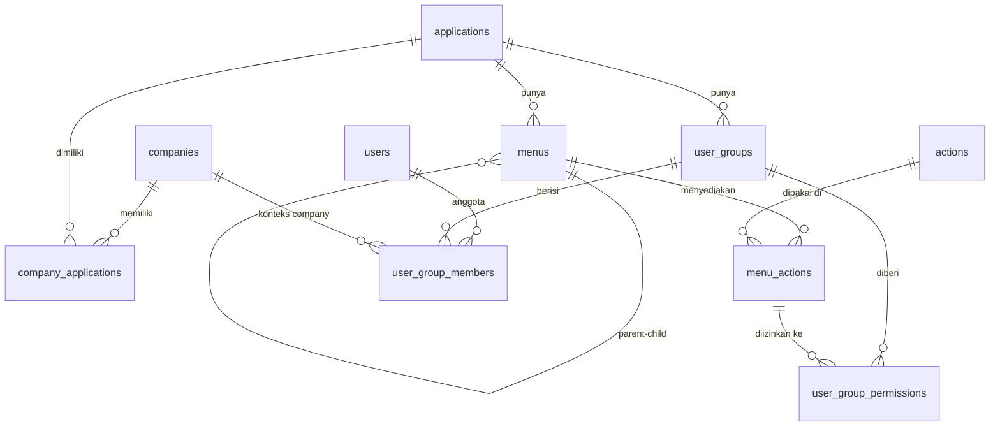

# PRD – User Management (RBAC) MODENA Framework · v2.0 (As-Built)

| Item | Keterangan |
|---|---|
| Dokumen | Product Requirements Document – Modul User Management, **versi as-built** |
| Versi | 2.0 |
| Tanggal | 16 Oktober 2026 |
| Pemilik | Divisi IT MODENA Indonesia |
| Menggantikan | `docs/PRD_user_management.md` v1.0 (tetap disimpan sebagai riwayat) |
| Acuan database | `database/01_user_management.sql` (v0.5.0), `database/02_seed_sample_data.sql` |
| Pelengkap | `docs/BACKLOG_user_management.md` (status rinci per item), `apps/api/README.md`, `apps/web/README.md` |
| Tujuan dokumen | Acuan tunggal untuk melanjutkan atau mengembangkan ulang modul ini di sesi baru, berdasarkan apa yang **sudah dibangun dan diuji** |

**Label di dokumen ini**

| Label | Arti |
|---|---|
| **[D]** | Keputusan pemilik produk. Wajib diikuti |
| **[U]** | Usulan dari PRD v1 yang dipakai sebagai default dan sudah diterapkan; belum dikonfirmasi formal |
| **[I]** | Aturan tambahan yang muncul saat implementasi (tidak ada di PRD v1) dan sudah diterapkan; perlu ditinjau pemilik produk |
| ✅ / 🔶 / ⬜ | Selesai dan teruji / sebagian / belum dikerjakan |

> **Instruksi untuk AI coding agent / developer sesi baru**
> 1. Database adalah *source of truth*. Jangan mengubah struktur tabel di luar file SQL di `database/`. Jangan memakai `prisma migrate`.
> 2. Baca §3 (status), §16 (sisa pekerjaan), dan §18 (jebakan teknis) sebelum menulis kode.
> 3. Ikuti pola modul yang sudah ada (§6) agar kode baru konsisten.
> 4. Jangan pernah menjalankan test/e2e yang menulis data terhadap database dev `modena`; gunakan `modena_test` (§15).
> 5. Bila ada hal yang tidak tercakup, catat sebagai open issue (§17); jangan berasumsi diam-diam.

---

## 1. Latar Belakang dan Tujuan

MODENA membangun framework pengembangan aplikasi internal. Modul pertama dan fondasinya adalah **User Management** berbasis **Role-Based Access Control (RBAC)** yang dipakai bersama oleh banyak aplikasi dan banyak perusahaan (company).

**Tujuan**

1. Satu sumber data user, group, dan hak akses untuk seluruh aplikasi internal.
2. Hak akses diatur sampai level **action per menu** (CREATE, READ, UPDATE, DELETE, PRINT, EXPORT_EXCEL, dan action tambahan).
3. Satu user dapat memiliki akses berbeda di company dan aplikasi yang berbeda.
4. Semua perubahan tercatat (audit field) dan tidak ada data yang dihapus permanen (soft delete).

**Ukuran keberhasilan [U]**: aplikasi baru (mis. Billing Cost) cukup mendaftarkan menu dan action-nya di modul ini; seluruh endpoint terlindungi oleh middleware otorisasi tunggal.

## 2. Ruang Lingkup

### 2.1 Fase 1 (MVP)

| # | Fitur | Status |
|---|---|---|
| 1 | Login LOCAL, logout, refresh token, ganti password, lockout **[D]** | ✅ |
| 2 | Pemilihan konteks aktif (company + aplikasi) setelah login | ✅ |
| 3 | Sidebar menu dinamis sesuai hak akses | ✅ |
| 4 | Middleware otorisasi berbasis menu + action (+ cache Redis) | ✅ |
| 5 | CRUD master: Companies, Applications, Menus (+ action per menu), Actions, Users | ✅ |
| 6 | Pemetaan: Company Applications, User Groups, Group Members, Group Permissions | ✅ |
| 7 | Soft delete, restore, aktif/nonaktif, lock/unlock user, reset password | ✅ |
| 8 | Export Excel daftar user; Import Excel user **[U]** | ✅ |
| 9 | Tema tampilan Terang / Gelap / Ikuti sistem **[I]** (permintaan tambahan pemilik produk) | ✅ |
| 10 | Hardening: rate limit login, logging terstruktur, uji kinerja | ⬜ (§16) |

### 2.2 Di luar lingkup Fase 1

- Login LDAP / SSO (kolom `auth_provider` sudah ada; user LDAP ditolak saat login) → Fase 2 **[D]**
- Audit log riwayat perubahan per field → Fase 2 (OI-05)
- Riwayat login / session management lintas device → Fase 2 (OI-03)
- Pembatasan admin per company → OI-01
- Fitur bisnis aplikasi lain (BILLCOST, INVDEMO hanya data contoh; halamannya masih placeholder)

## 3. Ringkasan Status (per 16-10-2026)

| Tahap | Lingkup | Status | Bukti |
|---|---|---|---|
| 0 | DDL + seed di database dev `modena` | ✅ | 10 tabel, 1 view, 5 function, 14 trigger |
| 1 | Setup monorepo, DB/Redis, Prisma, format response, health check | 🔶 | Selesai kecuali npm workspaces di root dan `.gitattributes` |
| 2 | Auth backend | ✅ | AC-01 s.d. AC-04 lulus |
| 3 | Konteks, menu, permission, `authorize`, cache Redis | ✅ | AC-05 s.d. AC-07 lulus |
| 4 | Frontend dasar (login, konteks, ganti password, layout, guard) | ✅ | Diuji di browser terhadap backend asli |
| 5 | Companies, Applications, Actions, Company Applications | ✅ | AC-11, AC-12 lulus |
| 6 | Menus + action per menu | ✅ | AC-08 lulus |
| 7 | Users (CRUD, reset/lock/unlock, export/import) | ✅ | AC-15, AC-16 lulus |
| 8 | User Groups, Group Members, Group Permissions | ✅ | AC-09, AC-10, AC-13, AC-14 lulus |
| 9 | Hardening | ⬜ | Lihat §16 |

**Angka uji terakhir**: 143 test integrasi backend lulus (8 file). Uji browser (Playwright, skrip di luar repo) per halaman: Companies 34, Applications 26, Actions 26, Menus 35, Company Applications 15, Users 41, User Groups + Group Members 50, Group Permissions 25, Tema 11 skenario, semuanya lulus terhadap database `modena_test`.

**Repository**: https://github.com/JerryPeter/mdn-frmwrk (branch `main`). Hanya commit awal yang sudah di-push; seluruh pekerjaan Tahap 1–8 masih berupa perubahan lokal yang **belum di-commit**.

## 4. Glosarium

| Istilah | Arti |
|---|---|
| Company | Perusahaan/entitas (`companies`) |
| Application | Aplikasi internal, berdiri sendiri (`applications`) |
| Company Application | Aplikasi yang dimiliki company (`company_applications`) |
| Menu | Item navigasi aplikasi. `GROUP` = folder, `PAGE` = halaman |
| Action | Operasi di menu (CREATE, READ, …) (`actions`) |
| Menu Action | Action yang **tersedia** di menu (`menu_actions`) |
| User Group | Kumpulan hak akses dalam satu aplikasi (`user_groups`) |
| Group Permission | Menu action yang **diizinkan** untuk group (`user_group_permissions`) |
| Group Member | Keanggotaan user di group **untuk company tertentu**, dengan masa berlaku (`user_group_members`) |
| Konteks aktif | Pasangan company + aplikasi dalam satu sesi (claim `ctx` di JWT) |
| Permission key | `menu_code:action_code`, mis. `UM_USER:CREATE` |
| Group inti | Group `SUPER_ADMIN` di aplikasi `USRMGNT` (dilindungi, AD-01) |

## 5. Pengguna (Persona)

| Persona | Group (USRMGNT) | Kebutuhan |
|---|---|---|
| Super Administrator IT | `SUPER_ADMIN` | Mengelola seluruh master, group, hak akses |
| Auditor | `UM_AUDITOR` | Melihat semua halaman USRMGNT + export user, tanpa mengubah |
| Admin aplikasi | Group admin di aplikasinya | Memakai aplikasinya; tidak mengelola user **[U]** |
| User operasional | Group di aplikasinya | Login, pilih konteks, memakai menu sesuai akses |

## 6. Arsitektur dan Tech Stack (as-built)

### 6.1 Stack

| Layer | Teknologi (versi terpasang) |
|---|---|
| Frontend | React 18.3, TypeScript, Vite 6, Tailwind CSS 3, React Router 6.28, TanStack Query 5, Zustand 5, Axios, lucide-react, clsx |
| Backend | Node.js (diuji di Node 25 lokal; target produksi Node 20 LTS), Express 4, TypeScript ESM (`NodeNext`, import berakhiran `.js`), Prisma 5.22 (`multiSchema`), Zod 3, jsonwebtoken, bcryptjs, cookie-parser, helmet, cors, exceljs 4, multer 2 |
| Database | PostgreSQL (lokal 18.3; DDL kompatibel 16+), database `modena`, schema `usrmgnt` |
| Cache | Redis 7-kompatibel (lokal: Memurai di Windows, `localhost:6379`) |
| Test | Vitest 2 + Supertest (integrasi backend); Playwright-core + Chrome headless (browser, belum di repo) |

### 6.2 Struktur repository

```
MODENA-FRMWRK/
├── database/                        # DDL (source of truth), data dictionary, seed
├── docs/
│   ├── PRD_user_management.md       # v1.0 (riwayat)
│   ├── PRD_user_management_v2.md    # dokumen ini
│   └── BACKLOG_user_management.md   # status rinci per item
└── apps/
    ├── api/
    │   ├── prisma/schema.prisma     # hasil `prisma db pull` (jangan diedit manual)
    │   ├── scripts/                 # dev-token.ts, reset-db.ts
    │   ├── tests/                   # Vitest + Supertest, global-setup membangun ulang modena_test
    │   └── src/
    │       ├── app.ts, server.ts
    │       ├── config/              # env (Zod), db (Prisma), redis
    │       ├── middlewares/         # auth (authenticate), authorize, error
    │       ├── lib/                 # jwt, permissions (cache), refresh-tokens, password,
    │       │                        # master-data (soft delete/restore/IN_USE), access (keanggotaan, SUPER_ADMIN)
    │       ├── modules/<nama>/      # *.routes / *.controller / *.service / *.schema
    │       └── utils/               # errors, response, validation, pagination, async-handler
    └── web/
        ├── index.html               # termasuk skrip tema anti-kedip
        ├── tailwind.config.js       # warna dipetakan ke CSS variable
        └── src/
            ├── api/                 # axios client + endpoint per modul
            ├── components/ui/       # komponen standar (§11.3)
            ├── hooks/               # useAuth, usePermission, useBootstrapSession, useDebounce
            ├── layouts/             # AuthLayout, AppLayout, Sidebar, UserMenu
            ├── lib/                 # format (WIB), icons, menu, password
            ├── mocks/               # mock API /auth/* (VITE_USE_MOCK=true)
            ├── pages/auth|system|usrmgnt/<halaman>/
            ├── routes/              # AppRouter, guards, registry
            ├── stores/              # session, toast, theme
            ├── styles/theme.css     # variabel warna terang/gelap
            └── types/
```

### 6.3 Pola modul backend (wajib diikuti untuk modul baru)

- **Routes** memasang `authorize(MENU, ACTION)` per endpoint; route statis (mis. `/export`) didaftarkan sebelum `/:id`.
- **Controller** mem-parse input dengan `parse(schema, req.body|query|params)` dan mengambil username audit dari `req.auth.username` (BR-15). Response lewat `ok(res, data, { status, message, meta })`.
- **Service** berisi logika bisnis; error lewat `AppError(status, code, message, details)`; helper `softDeleteData`, `restoreData`, `ensureNotInUse`, `duplicateCodeError`, `isUniqueViolation`.
- **Schema** Zod dengan pesan Bahasa Indonesia; kode bisnis di-`trim().toUpperCase()` (username: `toLowerCase()`); `optionalText(max)` mengubah string kosong menjadi `null`.
- Router dipasang di `app.ts` di belakang `authenticate()` + `requireApplication('USRMGNT')`.
- Setiap perubahan yang memengaruhi hak akses memanggil invalidasi cache (§7, BR-22).

### 6.4 Catatan Prisma

1. DDL dikelola lewat SQL di `database/`. `schema.prisma` dihasilkan dengan `npm run prisma:pull`.
2. `multiSchema` + `schemas = ["usrmgnt"]`.
3. Unique index adalah *partial index* (`WHERE is_deleted = false`) yang tidak terbawa ke Prisma. Gunakan `findFirst` + `is_deleted: false`, cek duplikat lebih dulu bila perlu pesan per field, dan tangani `P2002` sebagai cadangan.
4. View `user_effective_permissions` dibaca dengan `$queryRaw`.
5. Trigger database (validasi parent menu, validasi company anggota group, validasi aplikasi permission group, default action menu PAGE, `updated_at`) sudah ada; error trigger (`P0001`) diterjemahkan menjadi 422 `BUSINESS_RULE`.
6. Untuk relasi count gunakan `_count: { select: { rel: { where: { is_deleted: false } } } }`. Opsi `nulls: 'last'` pada `orderBy` hanya boleh untuk kolom nullable.

## 7. Model Data dan Alur Hak Akses

Detail kolom: `database/01_user_management.md`.



**Alur hak akses**: User → `user_group_members` (per company, masa berlaku) → `user_groups` (per aplikasi) → `user_group_permissions` → `menu_actions` (menu + action). View `user_effective_permissions` hanya memuat baris bila seluruh rantai aktif dan tidak terhapus (BR-10).

**Cache permission (Redis)**: key `perm:{user_id}:{company_id}:{application_id}`, isi `{ appCode, keys[] }`, TTL `PERMISSION_CACHE_TTL` (600 detik). Invalidasi: `invalidatePermissions.user/company/application/all` dan `invalidateGroupMembers(groupId)`. Bila Redis mati, permission dibaca langsung dari database.

**Refresh token (Redis)**: `refresh:{token}` → user_id dan `user_refresh:{user_id}` → set token, TTL `REFRESH_EXPIRES_IN`. Dicabut semua saat ganti/reset password, nonaktif, kunci, hapus user.

**Audit field di semua tabel [D]**: `created_by`, `created_at`, `updated_by`, `updated_at`, `deleted_by`, `deleted_at`, `is_deleted`, `is_active`.

## 8. Aturan Bisnis

### 8.1 Aturan dari PRD v1 (semua sudah diterapkan)

| Kode | Aturan | Lapisan |
|---|---|---|
| BR-01 s.d. BR-08 | Struktur data (company–aplikasi, menu per aplikasi, parent GROUP satu aplikasi, action katalog global, default CRUD untuk PAGE baru, group per aplikasi, keanggotaan per company, banyak group per user) | DB |
| BR-09 | Hak akses efektif = union permission semua group aktif user pada konteks | API |
| BR-10 | Hak akses hanya berlaku bila seluruh rantai aktif, tidak terhapus, dan dalam masa berlaku | DB (view) |
| BR-11 | Tidak ada hapus permanen (soft delete) | API |
| BR-12 | Kode bisnis unik di antara data yang belum dihapus; kode data terhapus boleh dipakai ulang | DB |
| BR-13 | Username dan email unik tanpa membedakan huruf besar/kecil | DB + API |
| BR-14 | User LOCAL wajib memiliki password | DB |
| BR-15 | Audit `*_by` diisi username dari JWT, bukan input client | API |
| BR-16 | 5 kali gagal login berturut-turut → terkunci; login sukses mereset hitungan **[U]** | API |
| BR-17 | `must_change_password = true` → semua endpoint selain `/auth/*` mengembalikan 403 `PASSWORD_CHANGE_REQUIRED` | API + Web |
| BR-18 | Password min. 8 karakter, huruf besar, huruf kecil, angka, simbol; tidak sama dengan password lama **[U]** | API + Web |
| BR-19 | User tidak dapat menghapus, menonaktifkan, atau mengunci akunnya sendiri | API + Web |
| BR-20 | Group SUPER_ADMIN (USRMGNT) minimal memiliki 1 anggota yang berlaku | API |
| BR-21 | Hapus data induk ditolak selama masih dipakai data turunan; pesan menyebut jumlahnya (`IN_USE`) | API |
| BR-22 | Perubahan permission, keanggotaan, status menginvalidasi cache permission yang terdampak | API |

### 8.2 Keputusan desain selama development [D]

| ID | Keputusan |
|---|---|
| AD-01 | Aplikasi `USRMGNT` dan group `SUPER_ADMIN` dikunci: tidak dapat dihapus atau dinonaktifkan |
| AD-02 | Action bawaan CREATE, READ, UPDATE, DELETE tidak dapat dihapus, diubah kodenya, atau dinonaktifkan |
| AD-03 | `GET /companies/:id/applications` mengembalikan seluruh aplikasi + penanda `is_assigned` |
| AD-04 | Hapus menu PAGE ikut men-soft-delete `menu_actions` dan permission group-nya dalam satu transaksi |
| AD-05 | READ tidak dapat dilepas dari menu PAGE |
| AD-06 | Email user boleh diubah; username tidak |

### 8.3 Aturan tambahan dari implementasi [I] (perlu ditinjau)

| Kode | Aturan | Modul |
|---|---|---|
| IR-01 | READ wajib tetap `is_default = true` (menu PAGE baru selalu mendapat READ) | Actions |
| IR-02 | Restore ditolak bila kodenya sudah dipakai data aktif lain (409 `DUPLICATE`) | Semua master |
| IR-03 | Melihat data terhapus (`include_deleted=true`) butuh permission UPDATE menu terkait | Semua list |
| IR-04 | Menu: tipe dan aplikasi tidak dapat diubah; parent boleh diubah dengan cek siklus; menu GROUP dengan sub-menu aktif tidak dapat dihapus; restore menu ditolak bila induknya masih terhapus; restore memulihkan data yang terhapus bersamaan (deleted_at sama) | Menus |
| IR-05 | Action nonaktif tidak dapat ditambahkan ke menu | Menus |
| IR-06 | Assign aplikasi ke company butuh company dan aplikasi aktif; lepas pemetaan ditolak bila masih dipakai keanggotaan group | Company Apps |
| IR-07 | Reset password ditolak untuk akun sendiri (gunakan Ganti Password) dan untuk user non-LOCAL | Users |
| IR-08 | Hapus user ikut men-soft-delete keanggotaannya (deleted_at sama); restore memulihkan keanggotaan yang group dan pemetaan company-aplikasinya masih ada | Users |
| IR-09 | BR-20 juga dijaga saat hapus/nonaktif/kunci user dan saat hapus/nonaktif/mengakhiri masa berlaku keanggotaan | Users, Members |
| IR-10 | `auth_provider` tidak dapat diubah setelah dibuat; Fase 1 hanya LOCAL yang dapat dibuat | Users |
| IR-11 | Hapus group ikut men-soft-delete permission-nya; restore memulihkannya (yang menu action-nya masih ada) | User Groups |
| IR-12 | Permission `UM_GROUP_PERM:READ` dan `UM_GROUP_PERM:UPDATE` tidak dapat dilepas dari SUPER_ADMIN | Group Permissions |
| IR-13 | Tambah anggota: user harus aktif; company harus memiliki aplikasi group (dicek di service dengan pesan jelas; trigger tetap pengaman) | Group Members |
| IR-14 | Group nonaktif tetap muncul di pemilih group (dengan penanda) agar anggota & permission-nya tetap dapat dikelola | Lookup |

## 9. Kebutuhan Fungsional (as-built)

### 9.1 Autentikasi dan Sesi ✅

- **Login** `POST /auth/login`: username case-insensitive; pesan gagal umum "Username atau password salah"; ditolak bila terhapus/nonaktif (`ACCOUNT_INACTIVE`), terkunci (`ACCOUNT_LOCKED`), atau bukan LOCAL (`AUTH_PROVIDER_NOT_SUPPORTED`, AS-01). Sukses: reset `failed_login_count`, isi `last_login_at`, kembalikan access token + profil + daftar konteks; refresh token di cookie.
- **Token**: access token JWT 15 menit (`sub`, `username`, opsional `ctx: { company_id, application_id }`). Refresh token acak 7 hari, cookie `refresh_token` (`httpOnly`, `sameSite=strict`, `secure` di produksi, path `/api/v1/auth`), dirotasi setiap refresh.
- **Konteks**: `GET /auth/contexts` (dikelompokkan per company, berisi nama + ikon, AS-02); `POST /auth/context` menerbitkan token baru dengan `ctx`. Frontend memilih otomatis bila hanya ada satu konteks.
- **Menu & permission**: `GET /auth/menus` = PAGE yang punya READ + seluruh GROUP leluhur, urut `sort_order`, termasuk `is_visible` (AS-03) dan action efektif per halaman; `GET /auth/permissions` = array permission key terurut.
- **Ganti password**: validasi BR-18; sukses mencabut semua refresh token dan mengembalikan access token baru (AS-04).
- **`authenticate()`** membaca ulang status user dari database di setiap request, jadi user yang baru dinonaktifkan/dikunci langsung tertolak.
- **Frontend**: setelah refresh token, konteks dipilih ulang otomatis (AS-05); reload halaman memulihkan sesi dan konteks terakhir.

### 9.2 Otorisasi ✅

- `requireApplication('USRMGNT')`: endpoint master hanya untuk token dengan konteks aplikasi USRMGNT. Tanpa `ctx` → 403 `CONTEXT_REQUIRED`.
- `authorize(menu, action)`: permission dari cache Redis/view; tidak ada → 403 `FORBIDDEN`.
- Frontend: `usePermission(menu, action)`, `<PermissionGate>`, guard `RequireAuth` → `RequirePasswordChanged` → `RequireContext` → `RequireMenuAccess` (halaman 403 bila tanpa READ). Tombol aksi disembunyikan bila tidak ada permission; backend tetap memeriksa.

### 9.3 Pola umum master ✅

| Fitur | Ketentuan |
|---|---|
| List | `page`, `page_size` (default 20, maks 100), `q` (case-insensitive), `is_active`, `sort_by` (whitelist), `sort_dir`, `include_deleted` (butuh UPDATE, IR-03) |
| Detail | `GET /:id`; 404 bila tidak ada/terhapus |
| Create / Update | Zod; kode bisnis tidak dapat diubah (boleh dikirim asal sama); audit dari JWT |
| Delete | Soft delete + cek BR-21 (`IN_USE`, 422) |
| Restore | `POST /:id/restore` (UPDATE); gagal bila kode dipakai data aktif (IR-02) |
| Status | `PATCH /:id/status` body `{ is_active }` (UPDATE) |
| Error | P2002/23505 → 409 `DUPLICATE` "Kode … sudah digunakan"; P0001 → 422 `BUSINESS_RULE`; 23503 → 422 `REFERENCE_NOT_FOUND` |

### 9.4 Companies – `UM_COMPANY` ✅

Field: `company_code` (wajib, maks 20, `^[A-Z0-9_]+$`), `company_name` (wajib, 200), `short_name` (50), `tax_number` (30), `address` (2000), `phone` (30), `email` (format email, 150), `logo_url` (URL, 500). Delete ditolak bila masih ada pemetaan aplikasi atau keanggotaan group. Status/hapus menginvalidasi cache company.

### 9.5 Applications – `UM_APPLICATION` ✅

Field: `app_code` (wajib, maks 30, `^[A-Z0-9_]+$`, unik global), `app_name` (150), `description`, `base_url`, `icon` (nama ikon lucide dari daftar `ICON_OPTIONS`), `sort_order` (0–9999). Response menyertakan `is_protected` (USRMGNT, AD-01). Delete ditolak bila masih ada menu, user group, atau pemetaan company.

### 9.6 Company Applications – `UM_COMPANY_APP` ✅

`GET /companies/:id/applications` → `{ company, items[] }` dengan `is_assigned`, `assigned_at/by`, `member_count` (AD-03). `POST` body `{ application_id }`; `DELETE /companies/:id/applications/:applicationId` (IR-06).

### 9.7 Actions – `UM_ACTION` ✅

Field: `action_code` (wajib, maks 30, `^[A-Z_]+$`), `action_name` (100), `description`, `is_default`, `sort_order`. Action bawaan dilindungi (AD-02, `is_builtin` di response). READ wajib default (IR-01). Perubahan `is_default` tidak retroaktif. Delete ditolak bila masih dipakai menu.

### 9.8 Menus – `UM_MENU` ✅

- `GET /applications/:id/menus/tree` (pohon admin, termasuk nonaktif/tersembunyi, opsi `include_deleted`), plus endpoint pola standar `/menus`.
- Field: `application_id`, `parent_id` (GROUP satu aplikasi), `menu_code` (maks 50, `^[A-Z0-9_]+$`), `menu_name` (150), `menu_type` (`GROUP`/`PAGE`), `route_path` (wajib untuk PAGE, diawali `/`; GROUP tanpa route), `icon`, `sort_order`, `is_visible`. Lihat IR-04.
- Action per menu: `GET /menus/:id/actions` (seluruh action + `is_assigned`, `is_required`, `group_count`); `PUT /menus/:id/actions` body `{ action_ids }` sebagai set lengkap; action yang dilepas ikut melepas permission group (AD-04, AD-05, IR-05).

### 9.9 Users – `UM_USER` ✅

- Field: `username` (3–100, `^[a-z0-9._]+$`, otomatis huruf kecil), `email` (wajib, format email, 150, otomatis huruf kecil), `full_name` (200), `employee_no` (30), `phone` (30), `auth_provider` (hanya LOCAL di Fase 1).
- Response **tidak pernah** berisi `password_hash` (AC-16); berisi `membership_count`.
- Create: password dari admin (wajib BR-18) **atau** dibangkitkan (12 karakter, tanpa karakter ambigu) dan dikembalikan sekali di `generated_password`; selalu `must_change_password = true`.
- Aksi (UPDATE): `POST /:id/reset-password` (password acak di `generated_password`, wajib ganti, cabut sesi, IR-07), `POST /:id/lock`, `POST /:id/unlock` (reset `failed_login_count` & `locked_at`). Lihat BR-19, IR-08, IR-09, IR-10.
- `GET /:id/memberships` (tab Akses): company, aplikasi, group, `valid_from`, `valid_to`, `status` ∈ `active | upcoming | expired | inactive | suspended`.
- Export `GET /users/export` (EXPORT_EXCEL): kolom username, full_name, email, employee_no, auth_provider, is_active, is_locked, last_login_at; mengikuti filter list; maks 10.000 baris.
- Import: `GET /users/import/template` (sheet "Users" + "Petunjuk"); `POST /users/import` multipart field `file` (.xlsx, maks 2 MB, maks 1.000 baris). Validasi semua baris (format, BR-18, duplikat dalam file, duplikat di database); error per baris dengan `field = "<nomor baris>.<kolom>"`; simpan dalam satu transaksi hanya bila semua valid; response berisi password bangkitan untuk baris tanpa password.

### 9.10 User Groups – `UM_GROUP` ✅

Field: `application_id` (tidak dapat diubah), `group_code` (maks 50, `^[A-Z0-9_]+$`, unik per aplikasi), `group_name` (150), `description`. Filter `application_id`. Response: `app_code`, `app_name`, `member_count`, `permission_count`, `is_protected`. Delete ditolak bila masih punya anggota; AD-01, IR-11. `POST /user-groups/:id/duplicate` (CREATE) body `{ group_code, group_name, description }`: group baru di aplikasi yang sama dengan salinan permission (anggota tidak disalin). Status/hapus menginvalidasi cache seluruh anggota.

### 9.11 Group Members – `UM_GROUP_MEMBER` ✅

`GET /user-groups/:id/members` (paginasi, `q` username/nama/email, `company_id`, sort `username|full_name|company_code|valid_from|valid_to|created_at`) dengan `user`, `company`, `status`. `POST` body `{ user_id, company_id, valid_from?, valid_to? }` (default `valid_from` = hari ini zona Asia/Jakarta; `valid_to ≥ valid_from`; duplikat → 409; IR-13, AC-09). `PUT /:memberId` hanya `{ valid_from, valid_to, is_active }`. `DELETE /:memberId` soft delete. BR-20/IR-09 dijaga; cache user terdampak diinvalidasi.

### 9.12 Group Permissions – `UM_GROUP_PERM` ✅

`GET /user-groups/:id/permissions` → `{ group, actions[], rows[], summary }`; `rows` = pohon menu aplikasi group (urutan DFS, `level`), tiap baris berisi `cells[]` hanya untuk action yang tersedia (`menu_action_id`, `granted`). `PUT` body `{ menu_action_ids }` sebagai set lengkap: hitung selisih, tambah yang baru, soft delete yang dilepas dalam satu transaksi, invalidasi cache seluruh anggota (AC-13); response matriks terbaru + `changes { added, removed }`. Menu action dari aplikasi lain → 422 (AC-10). IR-12.

### 9.13 Lookup (cukup token + konteks USRMGNT) ✅

| Endpoint | Isi |
|---|---|
| `GET /lookups/applications` | Aplikasi aktif `{ id, code, name, icon }` |
| `GET /lookups/companies?application_id=` | Company aktif; dengan `application_id` hanya yang memiliki aplikasi itu |
| `GET /lookups/actions` | Action aktif |
| `GET /lookups/users?q=&limit=` | User aktif `{ id, code: username, name, email }`, maks 50 |
| `GET /lookups/user-groups?application_id=` | Group belum terhapus (termasuk nonaktif, IR-14) + `app_code`, `member_count` |

## 10. Kontrak API

### 10.1 Konvensi

- Base URL `/api/v1`; JSON snake_case; tanggal ISO 8601 UTC (kolom `date` sebagai `YYYY-MM-DD`); header `Authorization: Bearer <token>`.
- Sukses: `{ "success": true, "data": …, "message": "OK", "meta"?: { page, page_size, total } }`
- Error: `{ "success": false, "error": { "code", "message", "details"?: [{ field, message }] } }`

| HTTP | `error.code` |
|---|---|
| 400 | `VALIDATION_ERROR` |
| 401 | `UNAUTHENTICATED`, `TOKEN_EXPIRED`, `INVALID_CREDENTIALS`, `ACCOUNT_LOCKED`, `ACCOUNT_INACTIVE`, `AUTH_PROVIDER_NOT_SUPPORTED` (AS-01) |
| 403 | `FORBIDDEN`, `CONTEXT_REQUIRED`, `PASSWORD_CHANGE_REQUIRED` |
| 404 | `NOT_FOUND` |
| 409 | `DUPLICATE` |
| 422 | `BUSINESS_RULE`, `REFERENCE_NOT_FOUND`, `IN_USE` |
| 429 | `TOO_MANY_REQUESTS` (belum ada rate limit, §16) |
| 500 | `INTERNAL_ERROR` |

### 10.2 Daftar endpoint

| Method | Path | Permission |
|---|---|---|
| GET | `/health` | – (status database & redis) |
| POST | `/auth/login` · `/auth/refresh` · `/auth/logout` | – (refresh via cookie) |
| GET · POST | `/auth/me` · `/auth/change-password` | token (boleh saat wajib ganti password) |
| GET · POST | `/auth/contexts` · `/auth/context` | token |
| GET | `/auth/menus` · `/auth/permissions` | token + konteks |
| GET | `/companies` · `/companies/:id` | `UM_COMPANY:READ` |
| POST | `/companies` | `UM_COMPANY:CREATE` |
| PUT · PATCH `/status` · POST `/restore` | `/companies/:id` | `UM_COMPANY:UPDATE` |
| DELETE | `/companies/:id` | `UM_COMPANY:DELETE` |
| GET · POST · DELETE `/:applicationId` | `/companies/:id/applications` | `UM_COMPANY_APP:READ/CREATE/DELETE` |
| GET · POST · PUT · PATCH · DELETE | `/applications` … (pola §9.3) | `UM_APPLICATION:*` |
| GET · POST · PUT · PATCH · DELETE | `/actions` … (pola §9.3) | `UM_ACTION:*` |
| GET | `/applications/:id/menus/tree` · `/menus` · `/menus/:id` · `/menus/:id/actions` | `UM_MENU:READ` |
| POST · PUT · PATCH · DELETE | `/menus` … · PUT `/menus/:id/actions` (UPDATE) | `UM_MENU:*` |
| GET | `/users` · `/users/:id` · `/users/:id/memberships` | `UM_USER:READ` |
| POST | `/users` | `UM_USER:CREATE` |
| PUT · PATCH `/status` · POST `/restore` `/reset-password` `/lock` `/unlock` | `/users/:id` | `UM_USER:UPDATE` |
| DELETE | `/users/:id` | `UM_USER:DELETE` |
| GET | `/users/export` | `UM_USER:EXPORT_EXCEL` |
| GET · POST | `/users/import/template` · `/users/import` | `UM_USER:IMPORT_EXCEL` |
| GET · POST · PUT · PATCH · DELETE | `/user-groups` … · POST `/:id/duplicate` (CREATE) | `UM_GROUP:*` |
| GET · POST · PUT `/:memberId` · DELETE `/:memberId` | `/user-groups/:id/members` | `UM_GROUP_MEMBER:*` |
| GET · PUT | `/user-groups/:id/permissions` | `UM_GROUP_PERM:READ/UPDATE` |
| GET | `/lookups/*` (§9.13) | token + konteks USRMGNT |

## 11. Kebutuhan UI/UX (as-built)

### 11.1 Halaman

| Halaman | Route | Isi utama | Status |
|---|---|---|---|
| Login | `/login` | Form, pesan per kode error, daftar akun uji (hanya dev), tombol tema | ✅ |
| Pilih konteks | `/select-context` | Kartu company → aplikasi; otomatis bila satu konteks | ✅ |
| Ganti password | `/change-password` | Checklist BR-18; dipaksa bila `must_change_password` | ✅ |
| Layout | – | Header (aplikasi, company aktif, tombol tema, Ganti konteks, menu profil), sidebar dari `/auth/menus`, drawer di tablet | ✅ |
| Beranda, 403, 404 | `/`, `/403`, `/404` | Informasi | ✅ |
| Companies | `/usrmgnt/companies` | Tabel (cari, tab status, tampilkan terhapus, sort, paginasi) + drawer tambah/ubah/detail + aksi status/hapus/pulihkan | ✅ |
| Applications | `/usrmgnt/applications` | Pola tabel + drawer; pemilih ikon; aplikasi inti dikunci | ✅ |
| Menus | `/usrmgnt/menus` | Pilih aplikasi (`?app=`), pohon menu, panel detail + checklist action per menu | ✅ |
| Actions | `/usrmgnt/actions` | Pola tabel + drawer; action bawaan dikunci | ✅ |
| Users | `/usrmgnt/users` | Filter status/terkunci/provider; aksi ubah, reset password, kunci/buka kunci, aktif/nonaktif, hapus/pulihkan; drawer tab Profil + Akses; dialog password sekali tampil; Export; dialog Import (template, error per baris, unduh hasil CSV) | ✅ |
| Company Applications | `/usrmgnt/company-applications` | Daftar company (`?company=`) → aplikasi dengan toggle; terkunci bila dipakai keanggotaan | ✅ |
| User Groups | `/usrmgnt/user-groups` | Filter aplikasi (`?app=`); tabel dengan jumlah anggota/permission sebagai tautan; drawer tambah/ubah/detail/duplikat | ✅ |
| Group Members | `/usrmgnt/group-members` | Pemilih group (`?group=`) → tabel anggota (status keanggotaan); modal tambah (cari user, company terfilter, masa berlaku) / ubah (masa berlaku + switch aktif) | ✅ |
| Group Permissions | `/usrmgnt/group-permissions` | **Tabel bertingkat 4 layer [D]**: Aplikasi → Group → Menu (pohon) → Action (kartu checkbox yang melipat). Centang per action, per menu, per folder menu; draft per group tidak hilang saat baris ditutup; Simpan/Batal di baris group; "Tampilkan semua action"; `?group=` membuka group terkait | ✅ |
| Halaman BILLCOST/INVDEMO | `/billcost/*`, `/invdemo/*` | Placeholder (di luar lingkup) | – |

Route frontend wajib sama dengan `menus.route_path`; daftarkan di `src/routes/registry.ts` (`path`, `menuCode`, `title`, `component`).

### 11.2 Standar interaksi

Konfirmasi sebelum hapus, nonaktif, kunci, reset password, lepas pemetaan, dan membuang perubahan; toast kanan bawah untuk hasil; validasi inline Bahasa Indonesia yang mengikuti aturan backend; error field dari server dipetakan ke field form; tombol aksi yang tidak diizinkan disembunyikan, aksi yang diblokir aturan bisnis dinonaktifkan dengan alasan di tooltip; tanggal tampil zona Asia/Jakarta (`formatDateTime`, `formatDate`); responsif 1280px dan tablet.

### 11.3 Komponen standar (`src/components/ui/`)

`Button`, `IconButton` (dengan `disabled` + alasan di title), `TextField` (termasuk tombol lihat password), `TextAreaField`, `Alert`, `Modal`/`Drawer` (opsi `wide`), `ConfirmDialog`, `StatusBadge` (Aktif/Nonaktif/Terhapus/Terkunci), `MembershipStatusBadge`, `Pagination`, `SortableHeader`, `SearchInput`, `StatusTabs`, `Switch`, `Spinner`, `Toaster`, `ThemeToggle`.

### 11.4 Tema terang / gelap [I] ✅

Pilihan Terang / Gelap / Ikuti sistem lewat `ThemeToggle` di header aplikasi dan halaman login; tersimpan di `localStorage` (`modena-theme`); diterapkan sebelum render pertama oleh skrip di `index.html`; mengikuti perubahan tema OS. Implementasi: warna `slate`, `white`, `brand`, `red`, `amber`, `emerald`, `sky` di `tailwind.config.js` dipetakan ke CSS variable di `src/styles/theme.css`; class `dark` di `<html>` mengganti nilainya. **Aturan komponen baru**: hanya gunakan keluarga warna tersebut; overlay pakai `bg-black/…`; elemen putih di atas latar berwarna pakai `text-white` atau nilai eksplisit `bg-[rgb(255_255_255/0.1)]`.

## 12. Kebutuhan Non-Fungsional

| Aspek | Kebutuhan | Status |
|---|---|---|
| Keamanan | `helmet`; CORS hanya `CORS_ORIGIN`; Zod di semua endpoint; query lewat Prisma/parameterized; tanpa `password_hash` di response | ✅ |
| Keamanan | Rate limit login 10 request/menit per IP | ⬜ |
| Kinerja | List < 500 ms untuk 10.000 baris; cek permission dari cache < 10 ms | ⬜ belum diukur |
| Konsistensi | Operasi set (permission, action per menu, import, cascade delete/restore) dalam satu transaksi | ✅ |
| Logging | Log request terstruktur JSON (request id, user_id, method, path, status, durasi) | ⬜ (saat ini hanya `console.error` untuk error 500) |
| Konfigurasi | Secret di `.env`, `.env.example` tersedia, env divalidasi Zod saat start | ✅ |
| Zona waktu | `timestamptz`; tampilan Asia/Jakarta; "hari ini" keanggotaan memakai Asia/Jakarta | ✅ |
| Bahasa | Label UI dan pesan error Bahasa Indonesia | ✅ |
| Testing | Integrasi backend ✅; browser e2e di repo ⬜ (FE-4.15); unit test service ⬜ | 🔶 |

## 13. Lingkungan, Konfigurasi, dan Menjalankan

**`apps/api/.env`** (salin dari `.env.example`; jangan di-commit): `NODE_ENV`, `PORT` (3000), `CORS_ORIGIN` (`http://localhost:5173`), `DB_HOST/PORT/NAME/USER/PASSWORD`, `DATABASE_URL` (`postgresql://…/modena?schema=usrmgnt`), `TEST_DB_NAME` (`modena_test`), `REDIS_URL`, `REDIS_KEY_PREFIX` (opsional), `PERMISSION_CACHE_TTL` (600), `JWT_SECRET` (min. 32 karakter), `JWT_EXPIRES_IN` (15m), `REFRESH_EXPIRES_IN` (7d).

**`apps/web/.env`**: `VITE_API_BASE_URL=/api/v1`, `VITE_API_PROXY_TARGET=http://localhost:3000`, `VITE_USE_MOCK=false` (mock hanya mencakup `/auth/*`).

| Perintah (di `apps/api`) | Fungsi |
|---|---|
| `npm run dev` | API di http://localhost:3000/api/v1 (tsx watch) |
| `npm test` | Test integrasi; `global-setup` membangun ulang `modena_test` dari DDL + seed |
| `npm run db:reset -- <db> [--yes]` | Bangun ulang database dari `database/*.sql` |
| `npm run dev:token -- superadmin MDN` | Token user seed untuk Postman/curl (ditolak di produksi) |
| `npm run prisma:pull` | Regenerasi `schema.prisma` bila DDL berubah |
| `npm run typecheck` | Pemeriksaan TypeScript |

| Perintah (di `apps/web`) | Fungsi |
|---|---|
| `npm run dev` | Web di http://localhost:5173 (proxy `/api` ke 3000) |
| `npm run build` / `npm run typecheck` | Build produksi / pemeriksaan TypeScript |

## 14. Data Seed dan Akun Uji

Password user LOCAL: **`Modena@2026`**.

| Username | Kondisi | Akses |
|---|---|---|
| `superadmin` | Normal | USRMGNT penuh (SUPER_ADMIN) di MDN dan DEMO1 |
| `auditor` | Normal | USRMGNT READ semua halaman + `UM_USER:EXPORT_EXCEL` di MDN |
| `bc.admin` | Normal | BILLCOST penuh di MDN |
| `bc.staff` | Wajib ganti password | BC_STAFF di MDN, BC_VIEWER di DEMO1 |
| `bc.viewer` | LDAP | Tidak dapat login di Fase 1 |
| `inv.admin` | Normal | INVDEMO penuh di MDN dan DEMO2 |
| `locked.user` | Terkunci | Login ditolak `ACCOUNT_LOCKED` |
| `inactive.user` | Nonaktif | Login ditolak `ACCOUNT_INACTIVE` |

Company: MDN, DEMO1, DEMO2. Aplikasi: USRMGNT, BILLCOST, INVDEMO. Kode menu USRMGNT: `UM_MASTER` (folder: `UM_COMPANY`, `UM_APPLICATION`, `UM_MENU`, `UM_ACTION`, `UM_USER`) dan `UM_ACCESS` (folder: `UM_COMPANY_APP`, `UM_GROUP`, `UM_GROUP_MEMBER`, `UM_GROUP_PERM`).

## 15. Kriteria Penerimaan dan Strategi Uji

| Kode | Skenario | Status |
|---|---|---|
| AC-01 | `superadmin` login → 2 konteks | ✅ |
| AC-02 | 5 kali password salah → terkunci | ✅ |
| AC-03 | `locked.user` / `inactive.user` ditolak | ✅ |
| AC-04 | `bc.staff` dipaksa ganti password | ✅ |
| AC-05 | `bc.staff` MDN-BILLCOST: CREATE, READ, UPDATE, PRINT, IMPORT_EXCEL | ✅ |
| AC-06 | `bc.staff` DEMO1-BILLCOST: hanya READ dan PRINT (tafsiran AS-06) | ✅ |
| AC-07 | `auditor` `POST /users` → 403 | ✅ |
| AC-08 | Menu PAGE baru otomatis CRUD | ✅ |
| AC-09 | Anggota untuk company tanpa aplikasinya → 422 | ✅ |
| AC-10 | Permission menu aplikasi lain → 422 | ✅ |
| AC-11 | Kode company duplikat → 409 | ✅ |
| AC-12 | Hapus lalu buat ulang company dengan kode sama | ✅ |
| AC-13 | Perubahan permission langsung berlaku | ✅ |
| AC-14 | `valid_to` lewat → akses hilang | ✅ |
| AC-15 | Audit field = username login | ✅ |
| AC-16 | Tanpa `password_hash` di response | ✅ |

**Strategi uji**

- Test integrasi backend di `apps/api/tests/*.test.ts` (satu file per modul), `fileParallelism: false`, prefix Redis `test:`, database `modena_test` dibangun ulang tiap run. Setiap file yang mengubah data seed wajib mengembalikannya di `afterAll` (contoh: `users.test.ts`, `user-groups.test.ts`).
- Uji browser dijalankan terhadap server terpisah: API `PORT=3001` dengan `DATABASE_URL` ke `modena_test` dan `REDIS_KEY_PREFIX=e2e:`, Vite `--port 5174` dengan `VITE_API_PROXY_TARGET=http://localhost:3001`. Reset `modena_test` dengan `db:reset` **setelah menghentikan** server 3001.

## 16. Sisa Pekerjaan (urutan usulan)

| ID | Pekerjaan | Ref |
|---|---|---|
| H9.2 | Rate limit `POST /auth/login` 10 request/menit per IP → 429 `TOO_MANY_REQUESTS` (halaman login sudah menangani pesannya) | §12 |
| H9.3 | Logging terstruktur JSON per request (request id, user_id, method, path, status, durasi), tanpa data sensitif | §12 |
| H9.4 | Unit test service + perluasan test integrasi | §12 |
| H9.5 | Uji kinerja list 10.000 baris dan cek permission dari cache | §12 |
| FE-4.15 | Pindahkan skrip uji browser ke repo (`apps/web/e2e`, Playwright) | §15 |
| SET-1.2 | npm workspaces di root monorepo | §6.2 |
| SET-1.1b | `.gitattributes` untuk konsistensi LF/CRLF | – |
| API-00.8 | Dokumentasi OpenAPI/Swagger (opsional) | – |
| GIT | Commit + push seluruh pekerjaan Tahap 1–8 (belum dilakukan) | §3 |

## 17. Keputusan yang Masih Menunggu

| Kode | Pertanyaan | Kondisi saat ini |
|---|---|---|
| AS-01 | Kode error login user LDAP = `AUTH_PROVIDER_NOT_SUPPORTED`? | Sudah diterapkan |
| AS-02 | Response konteks ditambah `company_name`, `app_name`, `app_icon`? | Sudah diterapkan |
| AS-03 | Node `/auth/menus` ditambah `is_visible`? | Sudah diterapkan |
| AS-04 | Ganti password mengembalikan access token baru? | Sudah diterapkan |
| AS-05 | Frontend memilih ulang konteks setelah refresh token? | Sudah diterapkan |
| AS-06 | AC-06 ditafsirkan sesuai seed (READ di Shipment, READ + PRINT di Report)? | Sudah diterapkan |
| IR-01 s.d. IR-14 | Aturan tambahan implementasi (§8.3) | Sudah diterapkan, perlu ditinjau |
| OI-01 | Pembatasan admin USRMGNT per company? | Master bersifat global |
| OI-02 | Kebijakan password, batas lockout (5), durasi token (15m/7d) dengan tim keamanan IT | Memakai nilai usulan |
| OI-03 | Login bersamaan di beberapa device? | Diizinkan (beberapa refresh token per user) |
| OI-04 | Detail integrasi LDAP/AD | Fase 2 |
| OI-05 | Tabel audit log terpisah? | Fase 2 |
| OI-06 | Aplikasi lain berbagi database (`modena`, schema per modul) atau memanggil API terpusat? | Terbuka |
| DATA-01 | Data contoh BILLCOST/INVDEMO: dipertahankan sebagai sample, dihapus, atau diganti data nyata? | Masih data seed |

## 18. Jebakan Teknis yang Sudah Ditemui

1. **Restart dev server setelah mengubah konfigurasi build.** Vite tidak memuat ulang `tailwind.config.js` selama berjalan; dark mode sempat "tidak berfungsi" karena server lama masih memakai konfigurasi lama.
2. **Jangan menjalankan skrip ad-hoc dengan `.env` default** bila skrip itu menulis data: `DATABASE_URL` di `.env` menunjuk database dev `modena`. Gunakan `npm run db:reset -- modena_test` atau set `DATABASE_URL` eksplisit.
3. **Mereset database saat server masih terhubung** menyebabkan Prisma `P1017`. Hentikan server 3001 sebelum `db:reset`.
4. **Proses node yatim di Windows** bisa tetap menahan port setelah task dihentikan; bebaskan dengan `netstat -ano` lalu `taskkill //PID <pid> //T //F`.
5. **`lookupsApi.*` yang menerima parameter** jangan dipasang langsung sebagai `queryFn` (TanStack Query mengirim context sebagai argumen pertama); bungkus dengan `() => lookupsApi.companies()`.
6. **Upload multipart dengan axios**: header default JSON membuat `FormData` diserialisasi; set `Content-Type: multipart/form-data`. Error dari download blob perlu di-parse ulang (sudah ditangani di interceptor `client.ts`).
7. **Prisma `nulls: 'last'`** hanya untuk kolom nullable; kolom non-null memakai `asc/desc` biasa.
8. **Pesan kebijakan password**: jangan `toLowerCase()` seluruh pesan karena "(A-Z)" ikut berubah; gunakan `lowerFirst`.
9. **Partial unique index** tidak terlihat oleh Prisma; cek duplikat di service bila perlu pesan per field.
10. **`tsx -e` tidak mendukung top-level await** (format CJS); tulis skrip ke file `.ts`/`.mjs`.

## 19. Riwayat Dokumen

| Versi | Tanggal | Perubahan |
|---|---|---|
| 1.0 | 13-10-2026 | Draft awal berdasarkan desain database v0.5.0 dan data seed |
| 2.0 | 16-10-2026 | Versi as-built: status Tahap 0–9, stack terpasang, pola modul, keputusan AD-01 s.d. AD-06, aturan implementasi IR-01 s.d. IR-14, kontrak API lengkap termasuk lookup & duplikat group, UI as-built (termasuk tabel bertingkat Group Permissions dan tema gelap), lingkungan & uji, sisa pekerjaan, keputusan tertunda, jebakan teknis |
